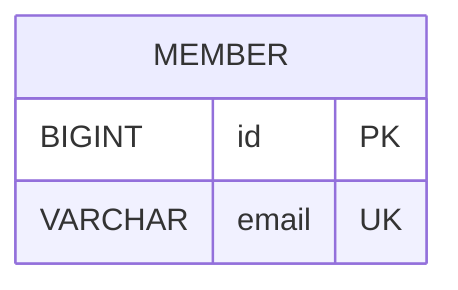

# DB 명세 작성 지침서
- ERD 와 테이블 명세를 `docs/db/schema.md` **한 파일**에 둔다. 새 기능은 기존 파일에 이어서 쓴다.
- 테이블·컬럼은 snake_case, 테이블은 단수형. PK 는 `id BIGINT AUTO_INCREMENT`, FK 는 `<참조테이블>_id`.
- API 명세의 모든 필드는 여기 컬럼과 맞아야 한다.
- 요구사항에 없는 정책(길이, 중복 허용 등)은 `결정 필요 D<번호>` 로 적고 `docs/decisions/<기능명>.md` 에 모은다.

````markdown
# DB 명세
## ERD

## member
| 컬럼 | 타입 | NULL | 키 | 설명 |
|---|---|---|---|---|
| id | BIGINT | N | PK | 회원 식별자 |
````
