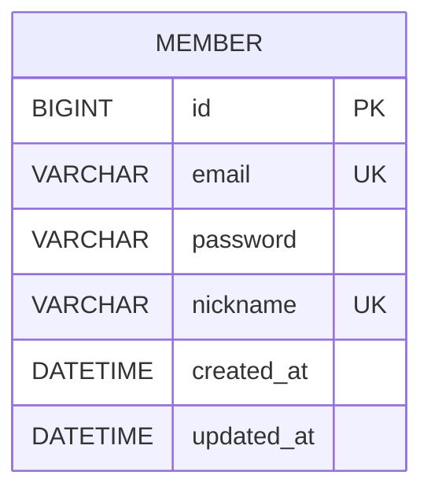

# DB 명세

## ERD

## member

| 컬럼 | 타입 | NULL | 키 | 설명 |
|---|---|---|---|---|
| id | BIGINT AUTO_INCREMENT | N | PK | 회원 식별자 |
| email | VARCHAR | N | UK | 로그인 이메일. 길이·형식 결정 필요 D1, 중복 불가 결정 필요 D2 |
| password | VARCHAR | N | | 암호화 저장 값. 저장 방식 결정 필요 D3, 검증 규칙 결정 필요 D4 |
| nickname | VARCHAR | N | UK | 회원 닉네임. 중복 불가. 길이 결정 필요 D5 |
| created_at | DATETIME | N | | 가입 일시 (BaseTimeEntity) |
| updated_at | DATETIME | N | | 수정 일시 (BaseTimeEntity) |
