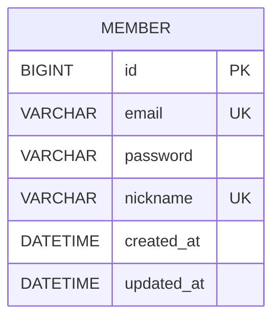
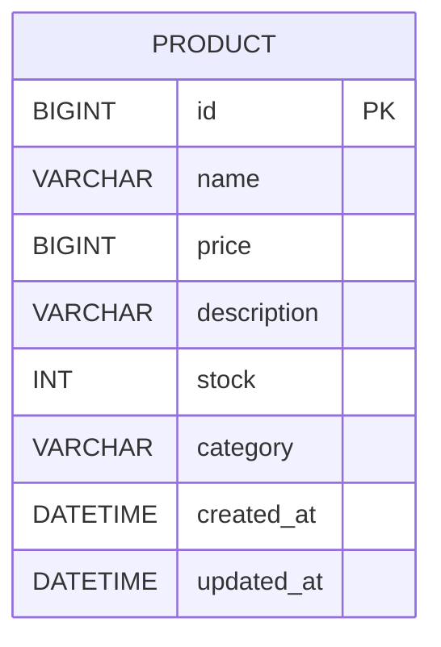

# DB 명세

## ERD

## member

| 컬럼 | 타입 | NULL | 키 | 설명 |
|---|---|---|---|---|
| id | BIGINT AUTO_INCREMENT | N | PK | 회원 식별자 |
| email | VARCHAR | N | UK | 로그인 이메일. 길이·형식 결정 필요 D1, 중복 불가 결정 필요 D2 |
| password | VARCHAR | N | | 암호화 저장 값. 저장 방식 결정 필요 D3, 검증 규칙 결정 필요 D4 |
| nickname | VARCHAR | N | UK | 회원 닉네임. 중복 불가. 길이 결정 필요 D5 |
| created_at | DATETIME | N | | 가입 일시 (BaseTimeEntity) |
| updated_at | DATETIME | N | | 수정 일시 (BaseTimeEntity) |

## ERD (상품)

## product

필드는 name, price, description, stock, category 로 정했다 (D11). description·stock·category 의 길이·범위·필수 여부는 결정 필요 D21. 상품과 회원의 관계(등록자)는 요구사항에 없어 두지 않는다 (결정 필요 D15).

| 컬럼 | 타입 | NULL | 키 | 설명 |
|---|---|---|---|---|
| id | BIGINT AUTO_INCREMENT | N | PK | 상품 식별자 |
| name | VARCHAR(100) | N | | 상품명. 1~100자 (D12), 중복 허용 (D14) |
| price | BIGINT | N | | 상품 가격(원 단위 정수). 0 이상 (D13) |
| description | VARCHAR(1000) | Y | | 상품 설명. 길이 결정 필요 D21 |
| stock | INT | N | | 재고 수량. 기본값 0. 범위 결정 필요 D21 |
| category | VARCHAR(50) | Y | | 카테고리. 길이 결정 필요 D21 |
| created_at | DATETIME | N | | 등록 일시 (BaseTimeEntity) |
| updated_at | DATETIME | N | | 수정 일시 (BaseTimeEntity) |

삭제 방식(물리/논리)은 결정 필요 D16. 추천값은 물리 삭제이므로 삭제 관련 컬럼은 두지 않는다.
